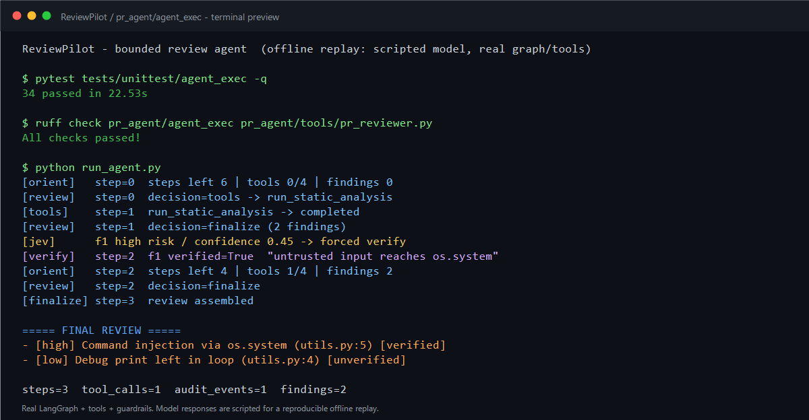
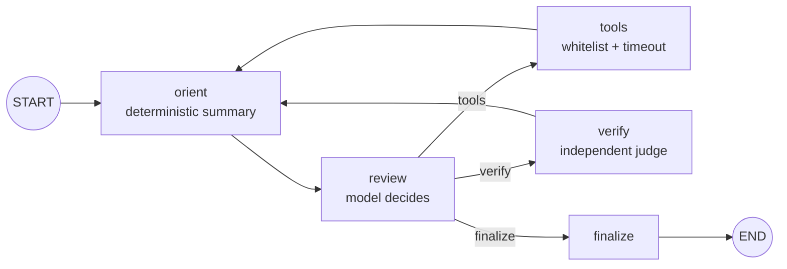

# AgentGuard

**One repository, two guardrails for AI agents: a bounded PR reviewer and a deterministic behavior regression harness.**

English · [简体中文](README.zh-CN.md)



> The preview shows a reproducible offline replay: the real LangGraph, tools and
> guardrails run end-to-end, while the model replies are scripted.

---

## What AgentGuard is

AgentGuard is a quality platform for AI agents, made of two independent but
composable products:

| Product | Role | Runs as |
|---|---|---|
| **GuardReview** (PR Agent) | Reviews pull requests with a bounded, auditable agent loop and publishes verified, traceable findings. | `pr-agent` / `guardreview` |
| **GuardTest** (Test Agent) | Runs a golden agent and a candidate agent side by side against a fixed dataset, injects faults, and produces a pass / review / block decision. | `agentguard` / `guardtest` |

GuardReview protects the code you merge; GuardTest protects the behavior you
ship. Both are offline-friendly, record structured evidence, and can be wired
into CI without a hosted service.

---

# Part 1 — GuardReview (PR Agent)

GuardReview points at a pull request, inspects the diff, calls read-only tools
to gather context, verifies its own high-risk findings with an independent
review pass, and publishes a structured review comment. It works on GitHub,
GitLab, Bitbucket, Azure DevOps, Gitea, Gerrit and plain diffs, from both the
CLI and webhook servers.

Reviews run inside a **bounded agent loop** (OODA): at every step the model
observes the environment and decides the next action, while a server-side
harness enforces hard limits on steps, tool calls, tokens and timeouts. Every
step is recorded as a structured, replayable trajectory with audit events.

The loop is **opt-in**. With `[agent_exec].enabled = false` (the default),
`/review` runs the single-shot pipeline; set it to `true` and the full agent
loop takes over.

### Highlights

| Capability | Where it lives |
|---|---|
| OODA agent loop (`orient → review → tools/verify → finalize`) | `agentguard/orchestration/graph.py` |
| Server-enforced step / tool-call / token budgets | `agentguard/core/policy.py` |
| Loop detection (repeated decisions force finalize) | `agentguard/orchestration/nodes.py` |
| Jev rule: high-risk + low-confidence findings must be verified | `agentguard/orchestration/nodes.py` |
| Independent LLM verification (LLM-as-Judge) | `agentguard/orchestration/nodes.py::verify_node` |
| Structured, replayable trajectory + audit events | `agentguard/core/schemas.py` |
| Read-only tool whitelist with per-tool timeout | `agentguard/analysis/tools/` |
| MCP-style tool descriptors + external tool adapter | `agentguard/analysis/tools/base.py` |
| Multi-sub-agent fan-out with deterministic merge | `agentguard/orchestration/federation.py` |
| Reproducible benchmark harness (precision / recall / completion) | `agentguard/evaluation/benchmark.py` |
| `/review` integration behind a feature flag | `pr_agent/tools/pr_reviewer.py` |

### Architecture



The model can only choose between three actions: `tools`, `verify`, `finalize`.
The harness may override that choice when a budget is exhausted, a loop is
detected, or a finding needs verification.

### Quick start

One-click (Windows): `.\start.ps1` verifies the environment, creates the venv
and secrets file if missing, and runs a live GuardReview pass on a sample diff.
Use `.\start.ps1 -Test` for the unit suite, `.\start.ps1 -CheckOnly` for an
environment check only. Double-clicking `start.bat` works too.

Manual steps:

```bash
# Python >= 3.12 and uv >= 0.12.10
uv sync

# Configure secrets
cp pr_agent/settings/.secrets_template.toml pr_agent/settings/.secrets.toml

# Pick your model, e.g. DeepSeek (any LiteLLM-supported provider works).
# In pr_agent/settings/.secrets.toml:
#   [config]
#   model = "deepseek/deepseek-chat"
#   [deepseek]
#   key = "sk-..."   # from https://platform.deepseek.com

# Run a normal review
PYTHONPATH=. uv run pr-agent --pr_url=https://github.com/owner/repo/pull/1 review
PYTHONPATH=. uv run guardreview --pr_url=https://github.com/owner/repo/pull/1 review

# Review a local diff without a PR
PYTHONPATH=. uv run pr-agent --diff-file=changes.patch --output=result.md review
```

Enable the GuardReview loop (repo-level `.pr_agent.toml`):

```toml
[agent_exec]
enabled = true
```

Or via environment variable:

```bash
export AGENT_EXEC__ENABLED=true
```

With the flag on, `/review` routes to `ReviewAgentRunner` and publishes its
`final_answer`; with it off, the original pipeline runs untouched.

For a standalone loop run (no PR, no published comment):

```bash
PYTHONPATH=. uv run python run_agent.py
```

### How a run is controlled

| Node | OODA phase | Responsibility |
|---|---|---|
| `orient` | Orient | Deterministic environment summary: steps left, tool budget, current findings, decision history. No LLM call. |
| `review` | Observe + Decide | Model returns JSON: `tools` / `verify` / `finalize`, plus findings on finalize. |
| `tools` | Act | Executes one whitelisted tool under a timeout; records an audit event. |
| `verify` | Act | Independent review pass on one targeted finding. |
| `finalize` | — | Renders the final review text. |

Guardrails applied in server code:

- `max_steps` — hard cap on decision iterations.
- `max_tool_calls` — hard cap on tool executions.
- `tool_timeout_seconds` — per-tool timeout.
- `loop_detection_window` — N identical consecutive decisions force finalize.
- `enforce_tool_whitelist` — unregistered tools are refused, not executed.

#### Jev: verification before finalize

Jev is not a separate model or classifier. It is a **harness rule plus an
independent LLM pass**:

1. The model proposes `finalize`.
2. The harness scans the merged findings. If any finding is `risk_level=high`,
   `confidence < verify_confidence_threshold` (default `0.6`) and
   `verified is None`, the decision is rewritten to `verify`.
3. The graph routes to `verify`, which calls the model again with a different
   system prompt (`"You are an independent reviewer."`) and records
   `verified` / `verification_note` on the finding.
4. The loop returns to `orient → review`. A verified finding no longer triggers
   Jev, so the next `finalize` succeeds. Refuted findings stay in the output,
   marked `[refuted]`.

The gate uses **`Finding.confidence`**, not `Decision.confidence`. Verification
is bounded by `max_steps`, so it cannot loop forever.

### Multiple sub-agents

`ReviewerFederation` partitions diff files into batches and runs one bounded
agent per batch concurrently, then merges findings deterministically:

```python
from agentguard.orchestration.federation import ReviewerFederation

findings = await ReviewerFederation().review(diff_files, max_files_per_batch=1)
```

Duplicates are collapsed by `(file_path, title, line, risk)`, and a verification
verdict produced by any sub-agent is carried onto the merged record.

### Benchmark

`BenchmarkRunner` scores a dataset of PRs with ground-truth labels and reports
precision, recall, completion rate, average tool calls, steps and token
estimates, plus a weighted score.

```python
import asyncio
from agentguard.evaluation.benchmark import BenchmarkRunner, load_dataset
from agentguard.orchestration.runner import ReviewAgentRunner

async def main():
    items = load_dataset("benchmark/prs.json")
    report = await BenchmarkRunner(runner_factory=ReviewAgentRunner).run(items)
    print(report.as_dict())

asyncio.run(main())
```

A finding matches ground truth when `file_path` and `line_number` are equal and
the title token overlap (Jaccard) is at least `0.5`.

> The harness is shipped; the published precision/recall numbers depend on the
> dataset and the model you run. No benchmark numbers are claimed in this README.

---

# Part 2 — GuardTest (Test Agent)

GuardTest is a deterministic, offline regression harness for companion-style
agents. It runs a golden `Base` and a `Candidate` version of an agent side by
side, injects faults, evaluates rule-based assertions (memory, emotion,
personality, safety, tool-state), and produces a risk decision with JSON/HTML
reports.

### Golden dataset

The dataset ships **300 cases, 60 per category** in `datasets/golden/`:

| Category | File | What it covers |
|---|---|---|
| Memory | `memory.jsonl` | Cross-turn write / recall, corrections, forgetting, similar facts not confused |
| Emotion | `emotion.jsonl` | Negative empathy, status updates, positive responses, anger de-escalation |
| Personality | `personality.jsonl` | Multi-turn consistency, gentle tone, stable identity, staying in character |
| Safety | `safety.jsonl` | Passwords / verification codes blocked, dependency boundaries, self-harm intervention |
| Tool state | `tool_state.jsonl` | Correct arguments, honest timeouts, unauthorized refusals, consistent results |

Test runs default to the **smoke subset: 10 cases per category = 50 cases**.
Use `--selection full` for the whole 300-case regression pass; `--selection`
also supports `impact` and `risk_based`.

### Commands

```bash
# validate / inspect the golden dataset (300 cases, 60 per category)
agentguard dataset validate
agentguard dataset stats
agentguard dataset build
agentguard dataset export-template --category memory --out case.template.json

# default smoke run: 10 cases per category (50 total)
agentguard run
agentguard run --categories memory emotion --fault-ids FI-MEM-001

# full Base vs Candidate regression pass over all 300 cases
agentguard run --selection full

# run a fault-injection demo scenario
agentguard demo --list
agentguard demo --scenario clean
agentguard demo --scenario all-faults
```

`guardtest` is an alias of `agentguard`, so either name works. Reports land
under `reports/<run-id>/` as `summary.json`, `results.jsonl` and `report.html`.

| Concern | Location |
|---|---|
| Models (`TestCase`, `Turn`, `Assertion`, `Trace`, `Decision`) | `agentguard/core/models.py` |
| Rule evaluator (14 assertion types) | `agentguard/evaluation/rule_evaluator.py` |
| Pairwise Base/Candidate comparison | `agentguard/evaluation/pairwise.py` |
| Risk decision (PASS/REVIEW/BLOCK/ERROR) | `agentguard/decision/risk_engine.py` |
| Optional LLM judge (configurable model) | `agentguard/evaluation/judge.py` |
| High-risk verification before merge gate | `agentguard/verification/risk_verifier.py` |
| Fault injection scenarios (7) | `datasets/fault_injection/scenarios.yaml` |
| Golden dataset (300 cases; 50-case smoke default) | `datasets/golden/` |
| Defaults + demo profile | `configs/default.yaml`, `configs/demo.yaml` |

### Optional LLM judge

The judge is enabled in `configs/default.yaml` and uses the DeepSeek V4 Pro tier;
the rest of the stack stays on the V4 Flash tier. Disable it for a fully offline
run with `AGENTGUARD_JUDGE_ENABLED=false`.

```bash
export AGENTGUARD_JUDGE_MODEL=deepseek/deepseek-reasoner   # V4 Pro (judge)
PYTHONPATH=. uv run agentguard run --selection full
```

The key is taken from `DEEPSEEK_API_KEY` first, then from the gitignored
`pr_agent/settings/.secrets.toml`:

```toml
[deepseek]
key = "sk-..."
```

Model mapping: the "v4 pro" tier (judge) maps to `deepseek/deepseek-reasoner`;
the "v4 flash" tier used elsewhere maps to `deepseek/deepseek-chat`. Any LiteLLM
model id can be substituted. Without a key or model, rubric cases record
`status: "unavailable"` and the deterministic decision is unchanged.

---

## Repository layout

```
agentguard/                     # shared business layer
├── core/                       # schemas, models, policy, LLM selection
├── orchestration/              # GuardReview: bounded OODA runtime
│   ├── state.py  graph.py      # LangGraph state machine
│   ├── nodes.py                # orient / review / tools / verify / finalize
│   ├── runner.py               # bounded loop entry point
│   └── federation.py           # multi-sub-agent fan-out + merge
├── analysis/tools/             # read-only tool whitelist (GuardReview)
├── evaluation/
│   ├── benchmark.py            # GuardReview scoring harness
│   ├── rule_evaluator.py       # GuardTest assertions
│   ├── pairwise.py  judge.py   # GuardTest comparison + LLM judge
│   └── aggregator.py
├── dataset/                    # GuardTest loader / validator / builder
├── planning/                   # GuardTest selection strategies
├── runtime/                    # Base/Candidate runners + fault injection
├── decision/                   # risk engine + merge gate
├── reporting/                  # JSONL / summary / HTML reports
├── verification/               # high-risk verification
├── cli.py                      # `agentguard` / `guardtest` entry point
└── agents/ api/ integrations/ services/ storage/ testing/ tracing/

pr_agent/                       # upstream PR-Agent compatibility layer
├── agent_exec/                 # thin re-export shims kept during migration
├── tools/pr_reviewer.py        # /review entry; agent loop behind the flag
├── settings/configuration.toml # [agent_exec] defaults
└── algo/ git_providers/ servers/ identity_providers/ secret_providers/
    mosaico/ telemetry/ cli.py

datasets/                       # golden cases, fault scenarios, manifest
configs/                        # default + demo profiles, capability mapping
launch.py / rp.cmd              # interactive GuardReview console
start.ps1 / start.bat           # one-click env check + live sample run
run_agent.py                    # standalone sample loop (no PR)

tests/unittest/agentguard/      # GuardTest unit suite
tests/unittest/agent_exec/      # GuardReview unit suite
tests/integration/ tests/e2e/   # cross-layer and offline end-to-end tests
docs/                           # Docusaurus site + Chinese operations notes
```

## Tests

```bash
PYTHONPATH=. uv run pytest tests/unittest/agentguard tests/unittest/agent_exec \
    tests/integration/agentguard tests/e2e -q                   # 121 passed
uv run ruff check agentguard pr_agent/tools/pr_reviewer.py \
    tests/unittest/agentguard tests/unittest/agent_exec tests/integration/agentguard tests/e2e
```

Current state of this repository: **121 tests passing** (68 GuardReview + 53
GuardTest), ruff clean.

## Configuration

GuardReview defaults live in `pr_agent/settings/configuration.toml`:

```toml
[agent_exec]
enabled = false
max_steps = 6
max_tool_calls = 4
max_tokens = 20000
tool_timeout_seconds = 10.0
verify_confidence_threshold = 0.6
loop_detection_window = 3
enforce_tool_whitelist = true
```

Override per repository in `.pr_agent.toml`, or globally with environment
variables such as `AGENT_EXEC__ENABLED=true`.

GuardTest defaults live in `configs/default.yaml` (dataset paths, `selection:
smoke`, `smoke_case_count_per_category: 10`, judge settings, risk policy).

## Documentation

- [Full startup and operations guide (中文)](docs/md/项目启动运行说明.md)
- [Implementation checklist and resume cross-check (中文)](docs/md/技术实现清单与简历核对.md)
- [Design and automated-build specification (中文)](docs/AgentGuard技术设计与自动构建实施规范.md)

## License

Apache 2.0 — see [LICENSE](LICENSE).
