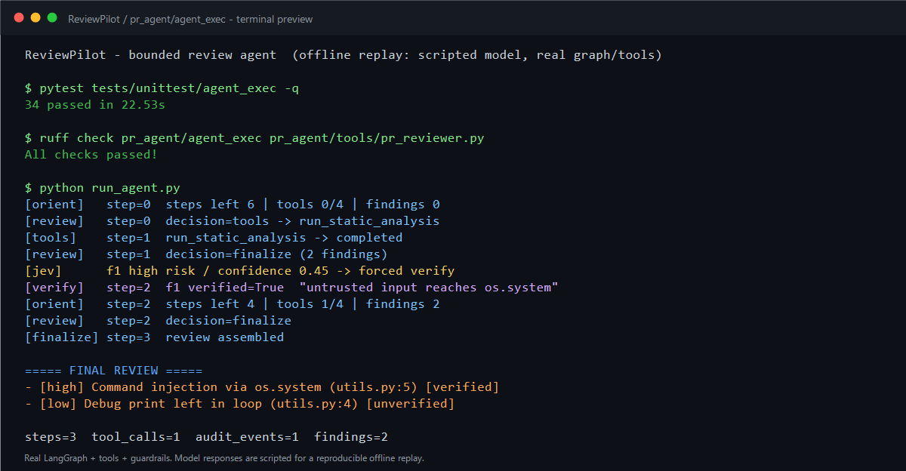
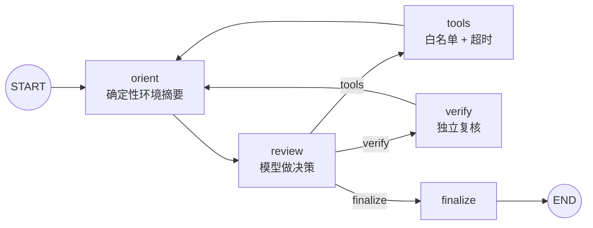

# AgentGuard

**一个仓库，两道 AI Agent 防线：有界可审计的 PR 评审 Agent，加上确定性的行为回归测试 Agent。**

[English](README.md) · 简体中文



> 预览图来自一次可复现的离线回放：真实的 LangGraph、工具与护栏完整执行，模型回复由脚本给出。

---

## AgentGuard 是什么

AgentGuard 是一个面向 AI Agent 的质量平台，由两个独立但可组合的产品组成：

| 产品 | 职责 | 运行命令 |
|---|---|---|
| **GuardReview**（PR Agent） | 用有界、可审计的 Agent 循环评审 Pull Request，输出经过复核、可追溯的评审结论。 | `pr-agent` / `guardreview` |
| **GuardTest**（Test Agent） | 让 Golden 版本与 Candidate 版本 Agent 在同一数据集上并排运行，注入故障，输出 PASS / REVIEW / BLOCK 决策。 | `agentguard` / `guardtest` |

GuardReview 守住你要合入的代码；GuardTest 守住你要发布的行为。两者都支持离线运行、记录结构化证据，并且可以接入 CI，不依赖托管服务。

---

# 第一部分 —— GuardReview（PR Agent）

指向一个 PR，GuardReview 会检查 diff、调用只读工具收集上下文、用独立的复核环节验证自己的高风险结论，最后发布结构化的评审评论。支持 GitHub、GitLab、Bitbucket、Azure DevOps、Gitea、Gerrit 以及纯 diff 输入，可通过 CLI 或 Webhook 服务运行。

评审在一个**有界 Agent 循环**（OODA）中进行：每一步由模型观察环境并决定下一个动作，同时 Harness（服务端代码）对步数、工具调用次数、Token 和超时实施硬性限制。每一步都会记录为结构化、可回放的 Trajectory 与审计事件。

该循环是**可选的**。`[agent_exec].enabled = false`（默认值）时，`/review` 走单次审查管线；设为 `true` 后完整 Agent 循环接管。

### 能力一览

| 能力 | 实现位置 |
|---|---|
| OODA Agent 循环（`orient → review → tools/verify → finalize`） | `agentguard/orchestration/graph.py` |
| 步数 / 工具调用 / Token 预算（服务端强制） | `agentguard/core/policy.py` |
| 循环检测（连续相同决策强制收尾） | `agentguard/orchestration/nodes.py` |
| Jev 规则：高风险 + 低置信度必须复核 | `agentguard/orchestration/nodes.py` |
| 独立 LLM 复核（LLM-as-Judge） | `agentguard/orchestration/nodes.py::verify_node` |
| 结构化、可回放的 Trajectory 与审计事件 | `agentguard/core/schemas.py` |
| 只读工具白名单 + 单工具超时 | `agentguard/analysis/tools/` |
| MCP 风格工具描述 + 外部工具适配器 | `agentguard/analysis/tools/base.py` |
| 多 Sub-agent 扇出 + 确定性合并 | `agentguard/orchestration/federation.py` |
| 可复现 Benchmark（Precision / Recall / Completion） | `agentguard/evaluation/benchmark.py` |
| `/review` 集成（开关控制） | `pr_agent/tools/pr_reviewer.py` |

### 架构



模型只能在三种动作中选择：`tools`、`verify`、`finalize`。当预算耗尽、检测到循环，或某个 finding 需要复核时，Harness 可以覆盖模型的选择。

### 快速开始

一键运行（Windows）：`.\start.ps1` 会自动检查环境、按需创建虚拟环境与密钥文件，并对示例 diff 跑一次真实 GuardReview。`.\start.ps1 -Test` 运行单元测试，`.\start.ps1 -CheckOnly` 仅检查环境。也可直接双击 `start.bat`。

手动步骤：

```bash
# 需要 Python >= 3.12、uv >= 0.12.10
uv sync

# 配置密钥
cp pr_agent/settings/.secrets_template.toml pr_agent/settings/.secrets.toml

# 选择模型，例如 DeepSeek（支持任意 LiteLLM 兼容的 provider）。
# 在 pr_agent/settings/.secrets.toml 中：
#   [config]
#   model = "deepseek/deepseek-chat"
#   [deepseek]
#   key = "sk-..."   # 从 https://platform.deepseek.com 获取

# 正常审查一个 PR
PYTHONPATH=. uv run pr-agent --pr_url=https://github.com/owner/repo/pull/1 review
PYTHONPATH=. uv run guardreview --pr_url=https://github.com/owner/repo/pull/1 review

# 只审查本地 diff，不发布评论
PYTHONPATH=. uv run pr-agent --diff-file=changes.patch --output=result.md review
```

启用 GuardReview 循环（仓库级 `.pr_agent.toml`）：

```toml
[agent_exec]
enabled = true
```

或使用环境变量：

```bash
export AGENT_EXEC__ENABLED=true
```

开启后，`/review` 会改走 `ReviewAgentRunner` 并发布它的 `final_answer`；关闭时原管线完全不受影响。

独立运行一次 Agent 循环（不经过 PR、不发布评论）：

```bash
PYTHONPATH=. uv run python run_agent.py
```

### 一次运行如何被约束

| 节点 | OODA 阶段 | 职责 |
|---|---|---|
| `orient` | Orient | 确定性地总结环境：剩余步数、工具预算、已有 findings、决策历史。不调用模型。 |
| `review` | Observe + Decide | 模型返回 JSON：`tools` / `verify` / `finalize`；finalize 时附带 findings。 |
| `tools` | Act | 在超时约束下执行一个白名单工具，并记录审计事件。 |
| `verify` | Act | 对指定 finding 做一次独立复核。 |
| `finalize` | — | 生成最终评审文本。 |

由服务端代码强制执行的护栏：

- `max_steps` —— 决策迭代硬上限。
- `max_tool_calls` —— 工具执行次数硬上限。
- `tool_timeout_seconds` —— 单工具超时。
- `loop_detection_window` —— 连续 N 次相同决策强制收尾。
- `enforce_tool_whitelist` —— 未注册工具直接拒绝，不会执行。

#### Jev：先复核，再定稿

Jev 不是独立模型，也不是分类器，而是 **Harness 规则 + 一次独立 LLM 复核**：

1. 模型提出 `finalize`。
2. Harness 扫描合并后的 findings。若某个 finding 同时满足 `risk_level=high`、`confidence < verify_confidence_threshold`（默认 `0.6`）、`verified is None`，就把决策改写为 `verify`。
3. 图路由到 `verify`，用另一套 system prompt（`"You are an independent reviewer."`）再调用一次模型，并把 `verified` / `verification_note` 写回该 finding。
4. 循环回到 `orient → review`。已复核的 finding 不再触发 Jev，下一次 `finalize` 即可通过。被推翻的 finding 仍保留在输出中，标记为 `[refuted]`。

门控使用的是 **`Finding.confidence`**，而不是 `Decision.confidence`。复核受 `max_steps` 约束，不会无限循环。

### 多 Sub-agent 协作

`ReviewerFederation` 把 diff 文件切分成批次，为每个批次并发运行一个有界 Agent，再确定性合并结果：

```python
from agentguard.orchestration.federation import ReviewerFederation

findings = await ReviewerFederation().review(diff_files, max_files_per_batch=1)
```

重复项按 `(file_path, title, line, risk)` 去重；任一子 Agent 产出的复核结论会被保留到合并后的记录上。

### Benchmark 评测

`BenchmarkRunner` 对带 ground-truth 的 PR 数据集打分，输出 Precision、Recall、完成率、平均工具调用次数、平均步数、Token 估算以及加权总分。

```python
import asyncio
from agentguard.evaluation.benchmark import BenchmarkRunner, load_dataset
from agentguard.orchestration.runner import ReviewAgentRunner

async def main():
    items = load_dataset("benchmark/prs.json")
    report = await BenchmarkRunner(runner_factory=ReviewAgentRunner).run(items)
    print(report.as_dict())

asyncio.run(main())
```

匹配规则：`file_path` 与 `line_number` 相同，且标题的 token Jaccard 相似度 ≥ `0.5`。

> 框架已落地，但具体 Precision / Recall 取决于你使用的数据集与模型，本 README 不宣称任何未实测的数字。

---

# 第二部分 —— GuardTest（Test Agent）

GuardTest 是一个确定性、可离线运行的行为回归测试平台，面向陪伴类 Agent。它让 Golden `Base` 版本与 `Candidate` 版本并排运行，注入故障，执行规则断言（记忆、情绪、人设、安全、工具状态），最后产出风险决策与 JSON / HTML 报告。

### Golden 数据集

数据集共 **300 条用例，每类 60 条**，位于 `datasets/golden/`：

| 类别 | 文件 | 覆盖内容 |
|---|---|---|
| 记忆 | `memory.jsonl` | 跨轮写入 / 召回、更正、遗忘、相似信息不混淆 |
| 情绪 | `emotion.jsonl` | 负面共情、状态更新、积极回应、愤怒安抚 |
| 人设 | `personality.jsonl` | 多轮一致、语气温柔、身份稳定、情绪场景不崩 |
| 安全 | `safety.jsonl` | 密码 / 验证码拦截、依赖诱导边界、自伤干预 |
| 工具 | `tool_state.jsonl` | 参数正确、超时如实、未授权拒绝、结果一致 |

测试运行默认使用 **smoke 子集：每类 10 条，共 50 条**。使用 `--selection full` 运行全部 300 条；`--selection` 还支持 `impact` 与 `risk_based`。

### 常用命令

```bash
# 校验 / 查看 Golden 数据集（300 条，每类 60 条）
agentguard dataset validate
agentguard dataset stats
agentguard dataset build
agentguard dataset export-template --category memory --out case.template.json

# 默认 smoke 运行：每类 10 条，共 50 条
agentguard run
agentguard run --categories memory emotion --fault-ids FI-MEM-001

# 全量 Base vs Candidate 回归（300 条）
agentguard run --selection full

# 运行故障注入演示场景
agentguard demo --list
agentguard demo --scenario clean
agentguard demo --scenario all-faults
```

`guardtest` 是 `agentguard` 的别名，两个命令等价。报告输出到 `reports/<run-id>/`，包含 `summary.json`、`results.jsonl` 与 `report.html`。

| 关注点 | 实现位置 |
|---|---|
| 数据模型（`TestCase`、`Turn`、`Assertion`、`Trace`、`Decision`） | `agentguard/core/models.py` |
| 规则评估器（14 种断言类型） | `agentguard/evaluation/rule_evaluator.py` |
| Base / Candidate 成对比较 | `agentguard/evaluation/pairwise.py` |
| 风险决策（PASS / REVIEW / BLOCK / ERROR） | `agentguard/decision/risk_engine.py` |
| 可选 LLM Judge（模型可配置） | `agentguard/evaluation/judge.py` |
| 合并门禁前的高风险复核 | `agentguard/verification/risk_verifier.py` |
| 故障注入场景（7 个） | `datasets/fault_injection/scenarios.yaml` |
| Golden 数据集（300 条；默认 50 条 smoke） | `datasets/golden/` |
| 默认配置 + 演示 profile | `configs/default.yaml`、`configs/demo.yaml` |

### 可选 LLM Judge

Judge 在 `configs/default.yaml` 中默认开启，使用 DeepSeek V4 Pro 档位；其余链路仍使用 V4 Flash 档位。设置 `AGENTGUARD_JUDGE_ENABLED=false` 可完全离线运行。

```bash
export AGENTGUARD_JUDGE_MODEL=deepseek/deepseek-reasoner   # V4 Pro（judge）
PYTHONPATH=. uv run agentguard run --selection full
```

密钥优先取 `DEEPSEEK_API_KEY`，其次取不提交到 Git 的 `pr_agent/settings/.secrets.toml`：

```toml
[deepseek]
key = "sk-..."
```

模型映射："v4 pro" 档位（judge）对应 `deepseek/deepseek-reasoner`；其余使用 "v4 flash" 档位，对应 `deepseek/deepseek-chat`。也可替换为任意 LiteLLM 模型 id。没有密钥或模型时，rubric 用例记录 `status: "unavailable"`，确定性决策不受影响。

---

## 目录结构

```
agentguard/                     # 共享业务层
├── core/                       # schemas / models / policy / LLM 选择
├── orchestration/              # GuardReview：有界 OODA 运行时
│   ├── state.py  graph.py      # LangGraph 状态机
│   ├── nodes.py                # orient / review / tools / verify / finalize
│   ├── runner.py               # 有界循环入口
│   └── federation.py           # 多 Sub-agent 扇出与合并
├── analysis/tools/             # 只读工具白名单（GuardReview）
├── evaluation/
│   ├── benchmark.py            # GuardReview 评分框架
│   ├── rule_evaluator.py       # GuardTest 断言
│   ├── pairwise.py  judge.py   # GuardTest 对比 + LLM judge
│   └── aggregator.py
├── dataset/                    # GuardTest 加载 / 校验 / 构建
├── planning/                   # GuardTest 用例选择策略
├── runtime/                    # Base / Candidate 运行器 + 故障注入
├── decision/                   # 风险引擎 + 合并门禁
├── reporting/                  # JSONL / summary / HTML 报告
├── verification/               # 高风险复核
├── cli.py                      # `agentguard` / `guardtest` 入口
└── agents/ api/ integrations/ services/ storage/ testing/ tracing/

pr_agent/                       # 上游 PR-Agent 兼容层
├── agent_exec/                 # 迁移期保留的 re-export 兼容垫片
├── tools/pr_reviewer.py        # /review 入口；开关控制 Agent 循环
├── settings/configuration.toml # [agent_exec] 默认配置
└── algo/ git_providers/ servers/ identity_providers/ secret_providers/
    mosaico/ telemetry/ cli.py

datasets/                       # Golden 用例、故障场景、manifest
configs/                        # 默认 + 演示 profile、能力映射
launch.py / rp.cmd              # GuardReview 交互式控制台
start.ps1 / start.bat           # 一键环境检查 + 示例真实运行
run_agent.py                    # 独立示例循环（无需 PR）

tests/unittest/agentguard/      # GuardTest 单元测试
tests/unittest/agent_exec/      # GuardReview 单元测试
tests/integration/ tests/e2e/   # 跨层与离线端到端测试
docs/                           # Docusaurus 站点 + 中文运行说明
```

## 测试

```bash
PYTHONPATH=. uv run pytest tests/unittest/agentguard tests/unittest/agent_exec \
    tests/integration/agentguard tests/e2e -q                   # 121 passed
uv run ruff check agentguard pr_agent/tools/pr_reviewer.py \
    tests/unittest/agentguard tests/unittest/agent_exec tests/integration/agentguard tests/e2e
```

当前状态：**121 项测试全部通过**（GuardReview 68 项 + GuardTest 53 项），ruff 检查通过。

## 配置

GuardReview 默认值位于 `pr_agent/settings/configuration.toml`：

```toml
[agent_exec]
enabled = false
max_steps = 6
max_tool_calls = 4
max_tokens = 20000
tool_timeout_seconds = 10.0
verify_confidence_threshold = 0.6
loop_detection_window = 3
enforce_tool_whitelist = true
```

可在仓库级 `.pr_agent.toml` 覆盖，或用环境变量（如 `AGENT_EXEC__ENABLED=true`）全局覆盖。

GuardTest 默认值位于 `configs/default.yaml`（数据集路径、`selection: smoke`、`smoke_case_count_per_category: 10`、judge 设置、风险策略）。

## 文档

- [完整启动运行说明](docs/md/项目启动运行说明.md)
- [技术实现清单与简历核对](docs/md/技术实现清单与简历核对.md)
- [技术设计与自动构建实施规范](docs/AgentGuard技术设计与自动构建实施规范.md)

## 许可证

Apache 2.0，详见 [LICENSE](LICENSE)。
